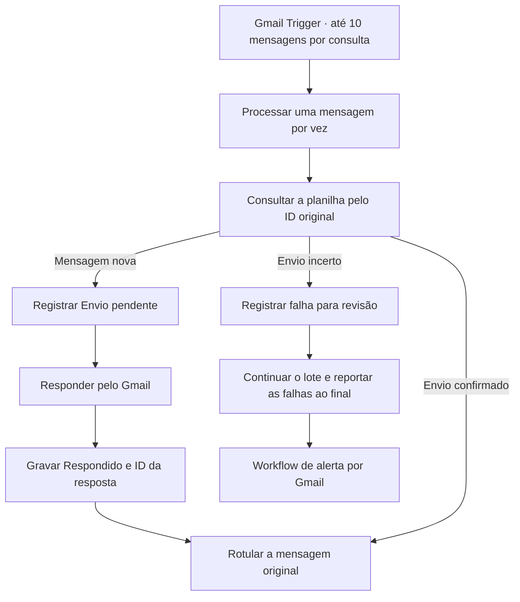

# EmailFlow Automation

Automação em n8n que registra e-mails recebidos no Google Sheets, envia uma confirmação pelo Gmail e sinaliza falhas em um workflow separado.



## Arquivos

- `workflows/emailflow-mvp.json` contém o processamento principal.
- `workflows/emailflow-alertas.json` contém a notificação de falhas de produção.
- `examples/contatos.csv` contém apenas os cabeçalhos esperados pela planilha.

## Checklist de instalação

- [ ] Clone ou baixe este repositório e abra uma instância do n8n. Os workflows foram exportados do n8n 2.45.6.
- [ ] No editor n8n, use **Import from File** para importar `workflows/emailflow-mvp.json` e `workflows/emailflow-alertas.json`. Mantenha o fluxo principal inativo durante a configuração.
- [ ] Crie no n8n as credenciais **Gmail OAuth2** e **Google Sheets OAuth2**. Em uma instância própria, habilite as APIs Gmail, Google Sheets e Google Drive no projeto Google Cloud, configure o consentimento OAuth e crie um cliente do tipo **Web application**. Cadastre a **OAuth Redirect URL** exibida pelo n8n, informe o **Client ID** e o **Client Secret** na credencial e autorize a conta Google. Se o aplicativo estiver em modo **Testing**, inclua a conta como usuária de teste. [Configuração OAuth2 do Google no n8n](https://docs.n8n.io/integrations/builtin/credentials/google/oauth-single-service/)
- [ ] No workflow principal, selecione a credencial Gmail em **Gmail Trigger**, **Reply to a message** e **Add label to message**. No workflow de alertas, selecione a credencial Gmail em **Enviar alerta por Gmail**.
- [ ] Crie uma planilha com uma aba chamada `Contatos` e importe a linha de cabeçalhos de `examples/contatos.csv`. Nos nós **Buscar registro pelo ID**, **Append or update row in sheet** e **Update row in sheet**, selecione a credencial do Sheets, a planilha e a aba.
- [ ] Na caixa Gmail conectada, crie o rótulo `EmailFlow-Respondido` e selecione-o em **Add label to message**. Copie o ID do rótulo do parâmetro `labelIds` desse nó no JSON do workflow e use-o na condição do nó **If**, no lugar de `SUBSTITUA_PELO_ID_DO_ROTULO`.
- [ ] Em **Gmail Trigger**, substitua `teste@example.com` pelo remetente autorizado para o teste. Em **Enviar alerta por Gmail**, substitua `alertas@example.com` pelo destinatário das notificações.
- [ ] Publique **EmailFlow - Alertas** e selecione-o como **Error workflow** nas configurações do workflow principal.
- [ ] Envie uma mensagem nova do remetente autorizado com o assunto `EMAILFLOW TEST` e faça uma execução manual completa do fluxo principal. Confirme que houve uma única resposta, que o rótulo foi aplicado e que a linha ficou com `Respondido` e `id_resposta`.
- [ ] Publique o workflow principal quando a validação terminar. Os alertas automáticos são disparados por falhas de produção. [Tratamento de erros no n8n](https://docs.n8n.io/flow-logic/error-handling/)

## Alterar o assunto ou o remetente do filtro

No editor, abra **Gmail Trigger → Filters → Search** e edite a busca Gmail. `subject:"NOVO CONTATO"` procura a frase no assunto. `from:teste@example.com` restringe o remetente e `-label:EmailFlow-Respondido` exclui mensagens já rotuladas.

Para editar o arquivo antes de importar, localize o nó **Gmail Trigger** em `workflows/emailflow-mvp.json` e mude `parameters.filters.q`.

```json
"q": "subject:\"NOVO CONTATO\" from:teste@example.com -label:EmailFlow-Respondido"
```

Se o workflow já estiver instalado, faça a alteração no editor e publique a nova versão para aplicá-la em produção.

A consulta e a gravação no Sheets são operações separadas. Execuções simultâneas podem disputar a mesma mensagem. O alerta também depende da credencial Gmail configurada.
