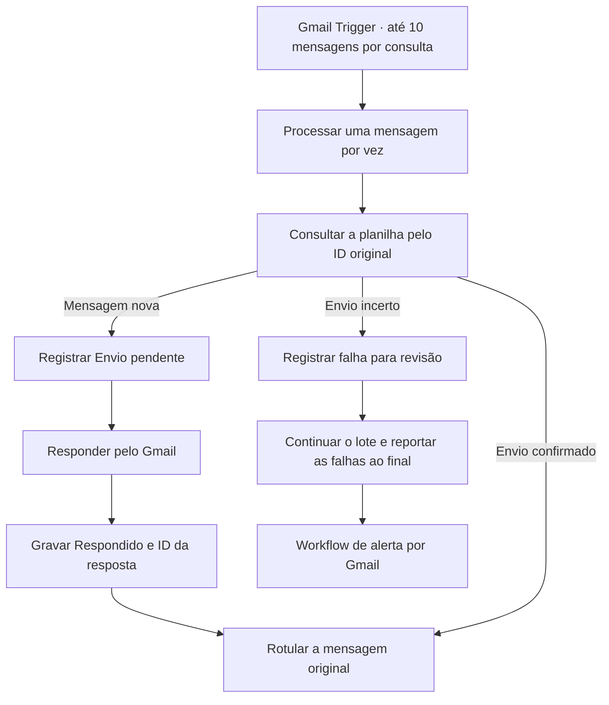

# EmailFlow Automation

Automação em n8n que registra e-mails recebidos no Google Sheets, envia uma confirmação pelo Gmail e sinaliza falhas em um workflow separado.

## Arquivos

- `workflows/emailflow-mvp.json` contém o processamento principal.
- `workflows/emailflow-alertas.json` contém a notificação de falhas de produção.
- `examples/contatos.csv` contém apenas os cabeçalhos esperados pela planilha.

## Configuração

1. Importe os dois arquivos JSON no n8n. O projeto foi preparado a partir do n8n 2.45.6.
2. Crie suas credenciais OAuth2 de Gmail e Google Sheets e selecione-as nos respectivos nós.
3. Crie uma planilha com uma aba chamada `Contatos` e importe os cabeçalhos do CSV. Selecione sua planilha e aba nos três nós de Google Sheets.
4. No Gmail, crie o rótulo `EmailFlow-Respondido`. Selecione-o em **Add label to message** e use o mesmo ID no nó **If**, no lugar de `SUBSTITUA_PELO_ID_DO_ROTULO`.
5. No gatilho, substitua `teste@example.com` por um remetente de teste. No workflow de alertas, troque `alertas@example.com` pelo endereço que vai receber as notificações.
6. Publique o workflow de alertas e selecione-o como **Error workflow** nas configurações do fluxo principal. Teste com uma caixa dedicada e um assunto controlado antes de publicar o fluxo principal.

## Como validar

- Mensagem nova: recebe uma resposta, o Sheets registra `Respondido` e `id_resposta`, e o Gmail recebe o rótulo.
- Mensagem já respondida: um reprocessamento com confirmação registrada pode concluir a rotulagem sem enviar de novo.
- Envio incerto: a mensagem fica pendente de conciliação manual. As demais mensagens do lote continuam.
- Uma falha em produção deve aparecer no histórico e acionar o workflow de alertas. Use uma conta de teste para exercitar esse cenário.

A consulta e a gravação no Sheets são operações separadas. Execuções simultâneas podem disputar a mesma mensagem. O alerta também depende da credencial Gmail configurada.

[Documentação de tratamento de erros do n8n](https://docs.n8n.io/flow-logic/error-handling/)
